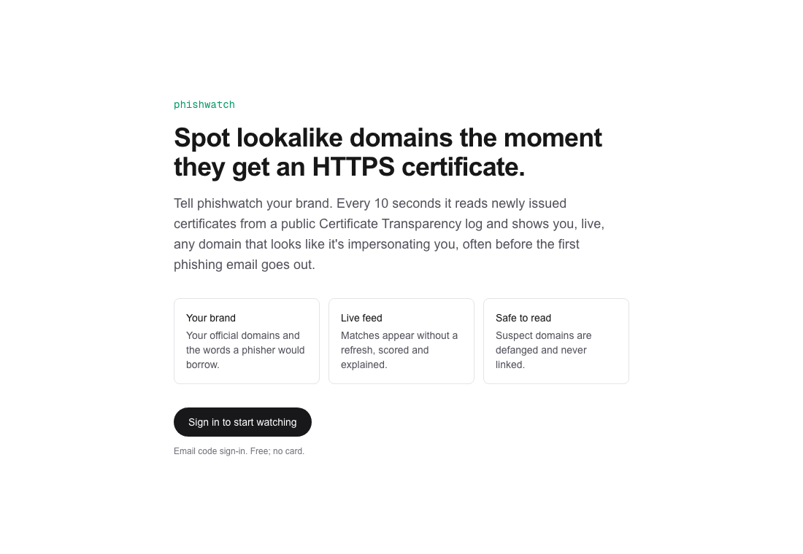
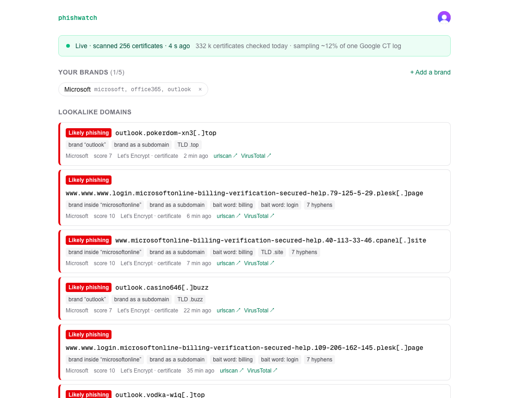
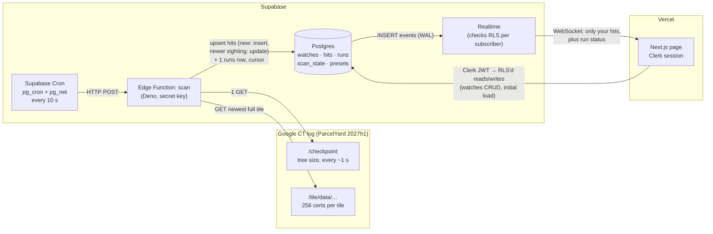

# phishwatch

You tell phishwatch your brand. Every 10 seconds it checks newly issued HTTPS certificates and shows you, live, any domain that looks like it's impersonating you.

**Live:** https://phishwatch-umber.vercel.app

Phishing sites need HTTPS to look trustworthy, and every publicly trusted certificate must be published in **Certificate Transparency (CT)** logs before browsers accept it. So when someone sets up `acmecu-login[.]top`, its certificate appears in a public log within seconds, often before the first phishing email is sent. phishwatch reads one of those logs continuously and flags names that imitate the brands its users register.

| Signed out | Signed in: the live feed |
|---|---|
|  |  |

## Using it

1. **Sign in** with your email (a one-time code; no password, no card).
2. **Add your brand:** a name, your official domains (1–3, e.g. `acmecu.org`) and the terms a phisher would borrow (1–5; suggested from your domain, e.g. `acmecu`). Or tap a preset such as PayPal or Microsoft.
3. **Watch the feed.** New matches slide in without a refresh. Each shows:
   - a severity: **likely phishing** (red), **suspicious** (amber) or **low** (grey; hidden unless you tick "Show low-risk matches")
   - the domain, **defanged** (`acmecu-login[.]top`) and never a link, because it may be a live phishing site
   - why it matched, in words ("lookalike “acrnecu”", "bait word: login", "TLD .top")
   - the issuing CA, whether it was a precertificate, when it was logged, and lookups on urlscan and VirusTotal
4. **Get told.** Suspicious and likely matches also raise a toast, add an unread count to the tab title while it's in the background, and (if you click "Notify me on this device") a system notification while the tab is hidden. Matches since your last visit on that device are tagged **New**.

The status bar at the top shows whether the scanner is working: **Live** (last run ok and under 30 s old, with today's total), **No update** (stale: no run for 30 s), **Scanner error** (down: the last run failed, with the error) or **Paused** (the kill switch is on), plus a **Reconnecting…** chip if the live connection drops. After 20 minutes without activity the page pauses its live connection to save quota; one click resumes it.

## How it works



1. **Supabase Cron** calls the `scan` Edge Function every 10 seconds, sending the secret key from Vault. The function rejects any caller without it (HTTP 401).
2. `scan` reads the log's **checkpoint** to learn its size, then downloads the **newest full tile**: 256 consecutive certificates, about 1 second of issuance.
3. It pulls the domain names out of each certificate (the Subject Alternative Name extension, read with a small DER parser), scores them against every brand, and **upserts** hits: a new `(brand, domain)` pair is inserted, a newer sighting of a known one updates `last_seen_at`/`seen_count`, and re-reading the same tile changes nothing. Every run, including a failed one, writes one `runs` row.
4. Postgres sends each insert to **Realtime**, which applies row-level security per subscriber, so each person receives only their own hits, plus run status for the freshness indicator.
5. The **page** signs in with Clerk. Supabase accepts the Clerk session token (third-party auth), and RLS keys on its `sub` claim. The page loads its first data directly, then listens on the WebSocket. The same token authorizes the socket: the page re-offers Clerk's current token every 10 s, so a rotation never lets it expire, and it rebuilds any channel the server closes.

### What breaks if a part changes

| Change | Effect | How it shows |
|---|---|---|
| Google rolls the log to a new shard (2027h2) or renames it | Checkpoint returns 404, so runs fail with `ok = false` | Page shows **down**. Fix: update `scan_state.log_url`; no redeploy needed. |
| The tile format changes | The parser throws, and the error is saved in `runs.error` | Page shows **down**, with the error |
| The cron stops | No new `runs` rows | Page shows **stale** after 30 s |
| The table is removed from the Realtime publication, or its policy or grant is dropped | The page silently receives nothing, with no error | The "last run" age keeps rising, so the page still shows **stale** |
| The Clerk JWT or the Supabase third-party auth setting changes | RLS denies every read | Empty feed. The Playwright two-user test catches it. |

## Scoring

A domain becomes a match only if it contains one of the brand's terms, as a whole word, a lookalike or glued to a telling word. Every point becomes a reason tag on the page.

| Signal | Points | Example |
|---|---|---|
| term match: exact word, lookalike, or glued to a bait word / digits / common add-on | +2 | `acmecu-…`, `myacmecu`, `acmeculogin` |
| lookalike rather than exact (Cyrillic letters, `rn`→`m`, `1`/`l`→`i`, one typo keeping the first letter) | +3 | `acrnecu`, `аcmecu` (punycode), `coilbase` |
| brand used as a subdomain of someone else's domain | +3 | `acmecu.org.verify-acct[.]top` |
| bait words (login, verify, secure, account, billing, …) | +2 each, max +4 | `acmecu-login…` |
| risky TLD (.top, .xyz, .click, .shop, …) | +2 | `…[.]top` |
| 3+ hyphens | +1 | `acmecu-secure-login-verify[.]top` |

**≥ 7 likely phishing, 4–6 suspicious, 2–3 low.** The brand's official domains and their subdomains are never flagged. A word that merely contains the term doesn't count (`prometall` isn't Meta; `pineapple` isn't Apple), and infrastructure that floods the log (AWS, CloudFront, Plex, some Heroku hostnames) is dropped before scoring. Two rules came from the first day of live data: glued words must be telling (so `bsicloud` isn't iCloud), and a one-letter typo must keep the first letter (so SAP's `ccloud` and Hetzner's `hcloud` aren't iCloud). A known limitation: a brand term used as a whole subdomain of an unrelated site scores high. `outlook.<casino-name>[.]top` comes up often and is more likely a mail-setup hostname on a spam site than Microsoft impersonation.

## What it can and can't see

- **It samples.** The log grows by roughly 170–230 certificates a second (8–9 tiles per 10 s). Each run reads the newest tile, so phishwatch sees **about 11–15% of this log's issuance**, ~2 M certificates a day. Every run records what it scanned and skipped. Reading everything needs an always-on streaming worker, beyond what a free Edge Function on a 10-second schedule should do.
- **It's one log.** Each certificate is logged to 2–3 logs run by different operators. Google's ParcelYard 2027h1 holds certificates expiring January–June 2027, which includes today's 90-day certificates, so it sees a large share, but not all.
- **CT can't see everything.** A phishing page on a hacked legitimate site, on a shared wildcard certificate (`*.pages.dev`), or on plain HTTP issues no new certificate for its name.
- **A match is a signal, not a verdict.** Scoring is name-based and explainable, not a classifier. Use the urlscan and VirusTotal links to look before acting.

## Running it

**Services** (all free tiers, no payment method): Supabase (Postgres, Edge Functions, Cron, Realtime, Vault), Clerk (email-code sign-in, connected to Supabase third-party auth), Vercel (Next.js hosting).

**Environment** (`.env.local`, never committed; the same four names on Vercel):

```
NEXT_PUBLIC_CLERK_PUBLISHABLE_KEY=
CLERK_SECRET_KEY=
NEXT_PUBLIC_SUPABASE_URL=
NEXT_PUBLIC_SUPABASE_PUBLISHABLE_KEY=
```

The Supabase **secret** key is never in this repo or on Vercel. The Edge Function receives it from Supabase at runtime, and the cron job reads it from Vault (`phishwatch_supabase_secret_key`, next to `project_url`).

```bash
npm install
npm run dev                                        # http://localhost:3000
npm test                                           # page helpers (node --test)
cd supabase/functions/scan && npx deno test --allow-read   # worker: parser, scorer, end-to-end on saved tiles
npx playwright test                                # browser tests (Clerk test users; needs .env.local)
PW_BASE_URL=https://phishwatch-umber.vercel.app npx playwright test   # the same tests against production
```

**Layout**

| Path | What |
|---|---|
| `supabase/migrations/` | schema, RLS, grants, Realtime publication, worker RPCs (`claim_scan`, `finish_scan`), cron jobs, `scan_stats`, the test hook |
| `supabase/functions/scan/` | the worker: `index.ts` (auth + wiring), `worker.ts` (one run), `tile.ts` (tile parser), `x509.ts` (SAN reader), `score.ts` (scorer), tests and fixtures (a real tile, openssl-made certificates) |
| `src/` | the page: a static shell plus a client app (`components/`), the Supabase client with Clerk tokens, live feed and status hooks (`lib/`) |
| `e2e/` | Playwright: signed-out page, add/remove a brand, two-user isolation with a live match, a 3.5-minute session (token rotation), recovery after the server closes a channel |
| `learning.md` | the "Ask Your Agent" answers for each build step |

## Operating it

- **Pause scanning:** `update scan_state set enabled = false;` Each run then exits at once and logs `note = 'disabled'`; the page shows **Paused**. Set it back to `true` to resume.
- **Stop the schedule:** `select cron.unschedule('scan-every-10s');`
- **Self-protection:** a lease stops overlapping runs; a 429/5xx from Google, or 5 failures in a row, pauses the worker for 5 minutes; at most 20 hits per brand per run; a stoplist of generic terms; at most 5 brands per user.
- **Retention:** `prune-daily` (03:17 UTC) deletes hits older than 30 days or beyond 1,000 per brand, runs older than 2 days, and cron history older than 1 day.
- **Health check** (SQL editor):

```sql
select
  (select count(*) from runs where ran_at > now() - interval '1 hour')                as runs_last_hour,   -- ~360
  (select count(*) from runs where not ok and ran_at > now() - interval '1 hour')     as failures_last_hour,
  (select max(ran_at) from runs)                                                       as last_run,
  (select count(*) from hits where created_at > now() - interval '1 day')             as hits_last_day,
  (select next_tile from scan_state)                                                   as cursor,
  pg_size_pretty(pg_database_size(current_database()))                                 as db_size;
```

### Free-tier budget

| Quota | Use |
|---|---|
| Supabase Edge Function invocations: 500 k/month | 8,640/day ≈ 268 k/month (54%) |
| Edge Function CPU: 2 s per call | 26–50 ms of parsing and scoring per run |
| Realtime messages: 2 M/month | one `runs` message per run per open tab (360 per tab-hour); the runs channel closes while the tab is hidden, and both channels after 20 idle minutes |
| Database: 500 MB | daily pruning keeps it small |
| Google's tile bucket (courtesy, not billing) | 1 checkpoint + 1 tile (~370 KB) per run, a `User-Agent` naming this repo, backoff on 429/5xx |

With no payment method on any service, the worst case at a limit is a paused service, never a bill.

### Things left in place on purpose

- **Five hidden demo brands** (PayPal, Microsoft, Apple, Amazon, Coinbase) owned by a placeholder user no one can sign in as. They keep the scanner producing matches for testing; RLS hides them from everyone.
- **A test hook**, `pw_test_insert_hit`, so the Playwright test can create a match on demand. It works only for the two Clerk development test accounts listed in `test_users`, only on their own brands, and only for `.invalid` domains, which can never be real sites.
