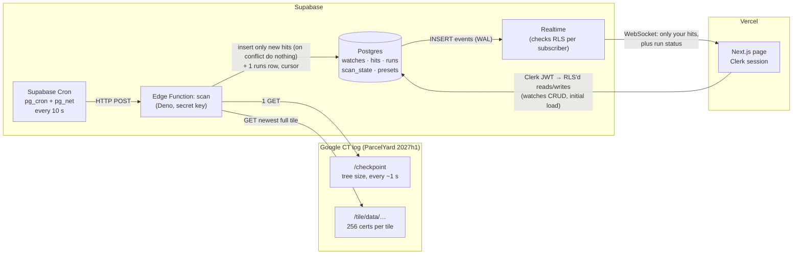

# phishwatch

You tell phishwatch your brand. Every 10 seconds it checks newly issued HTTPS certificates and shows you, live, any domain that looks like it's impersonating you.

**Live:** https://phishwatch-umber.vercel.app (work in progress)

## Data flow

1. **Supabase Cron** calls the `scan` Edge Function every 10 seconds.
2. `scan` reads the log's **checkpoint** to learn its size, then downloads the **newest full tile**: 256 consecutive certificates, about 1 second of issuance. The log grows by about 233 certificates a second, so each run samples about 1 tile in 9 (≈11%).
3. It pulls the domain names out of each certificate, scores them against every user's watched brands, and inserts only **new** hits. A unique `(watch_id, domain)` key plus `on conflict do nothing` makes reruns harmless. Every run writes one `runs` row, including failed runs.
4. Postgres sends each insert to **Realtime**. Realtime applies row-level security per subscriber, so each person receives only their own hits, plus run status for the freshness indicator.
5. The **page** signs in with Clerk. Supabase accepts the Clerk JWT, and RLS keys on its `sub` claim. The page loads its first data directly, then listens on the WebSocket, so it updates without a refresh.

### What breaks if a part changes

| Change | Effect | How it shows |
|---|---|---|
| Google rolls the log to a new shard (2027h2) or renames it | Checkpoint returns 404, so runs fail with `ok = false` | Page shows **down**. Fix: update `scan_state.log_url`; no redeploy needed. |
| The tile format changes | The parser throws, and the error is saved in `runs.error` | Page shows **down**, with the error |
| The cron stops | No new `runs` rows | Page shows **stale** after 30 s |
| The table is removed from the Realtime publication, or its policy or grant is dropped | The page silently receives nothing, with no error | The "last run" age keeps rising, so the page still shows **stale** |
| The Clerk JWT or the Supabase third-party auth setting changes | RLS denies every read | Empty feed. The Playwright two-user test catches it. |
